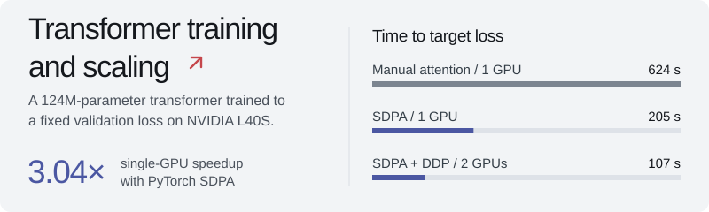
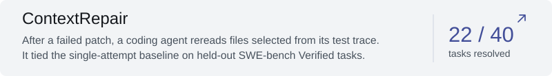
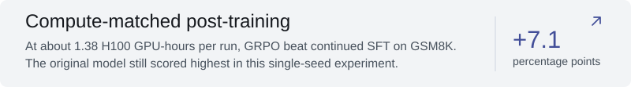
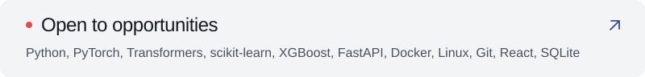

<picture>
  <source media="(max-width: 640px)" srcset="./assets/profile-mobile.svg">
  
</picture>

[Training](https://github.com/LL333111/transformer-training-scaling) &middot; [Agents](https://github.com/LL333111/ContextRepair) &middot; [Post-training](https://github.com/LL333111/rlvr-posttraining) &middot; [LinkedIn](https://www.linkedin.com/in/lucas-liu-6a83162a0/)

<a href="https://github.com/LL333111/transformer-training-scaling">
<picture>
  <source media="(max-width: 640px)" srcset="./assets/scaling-study-mobile.svg">
  
</picture>
</a>

<a href="https://github.com/LL333111/ContextRepair">
<picture>
  <source media="(max-width: 640px)" srcset="./assets/agent-recovery-mobile.svg">
  
</picture>
</a>

<a href="https://github.com/LL333111/rlvr-posttraining">
<picture>
  <source media="(max-width: 640px)" srcset="./assets/post-training-mobile.svg">
  
</picture>
</a>

## Other projects

- **[WatchAgent](https://github.com/LL333111/watchagent)** tracks hourly weather across three Canadian cities and flags transitions such as the onset of rain.
- **[Lucky Aces](https://github.com/LL333111/Full-Stack-Rewards--Community-Web-Platform)** delivers live reward notifications through a React and Express app.
- **[Student Response Classifier](https://github.com/LL333111/Student-Response-Classifier)** uses survey ratings and comments to identify which LLM a student evaluated.

<a href="https://www.linkedin.com/in/lucas-liu-6a83162a0/">
<picture>
  <source media="(max-width: 640px)" srcset="./assets/toolkit-mobile.svg">
  
</picture>
</a>

