# 

I'm a computer science student at the University of Toronto. I study how coding agents recover from failed patches and how much training time it takes to improve a language model. My undergraduate research focuses on search and retrieval.

## Selected experiments

### [ContextRepair](https://github.com/LL333111/ContextRepair)

Can a failed test tell a coding agent which files to read next? I built a retry loop that uses the failure trace to pick fresh repository context. On 40 held-out SWE-bench Verified tasks, it resolved 22, matching a single attempt. An independent retry resolved 21.

### [Compute-matched LLM post-training](https://github.com/LL333111/rlvr-posttraining)

I gave two copies of the same Qwen checkpoint about 1.38 H100 GPU-hours each. On GSM8K, verifier-guided reinforcement learning (GRPO) reached **55.6%** exact match and continued supervised fine-tuning reached **48.4%**. In this single-seed run, the original model still scored highest at 66.9%.

### [Transformer training and scaling](https://github.com/LL333111/transformer-training-scaling)

How quickly can a 124M-parameter transformer reach the same validation loss? On one L40S GPU, switching from manual attention to PyTorch's scaled dot-product attention cut training time to that target from **624 to 205 seconds**. With two GPUs and the same global batch size, it took **107 seconds**.

## Other projects

- [WatchAgent](https://github.com/LL333111/watchagent) tracks hourly weather in three Canadian cities and flags changes such as the onset of rain.
- [Lucky Aces](https://github.com/LL333111/Full-Stack-Rewards--Community-Web-Platform) is a rewards app built with React and Express, with live notifications over Socket.IO.
- [Student Response Classifier](https://github.com/LL333111/Student-Response-Classifier) uses survey ratings and written feedback to predict whether a student was evaluating ChatGPT, Claude, or Gemini.

I'm open to opportunities in machine learning and software engineering. [Connect on LinkedIn](https://www.linkedin.com/in/lucas-liu-6a83162a0/).
